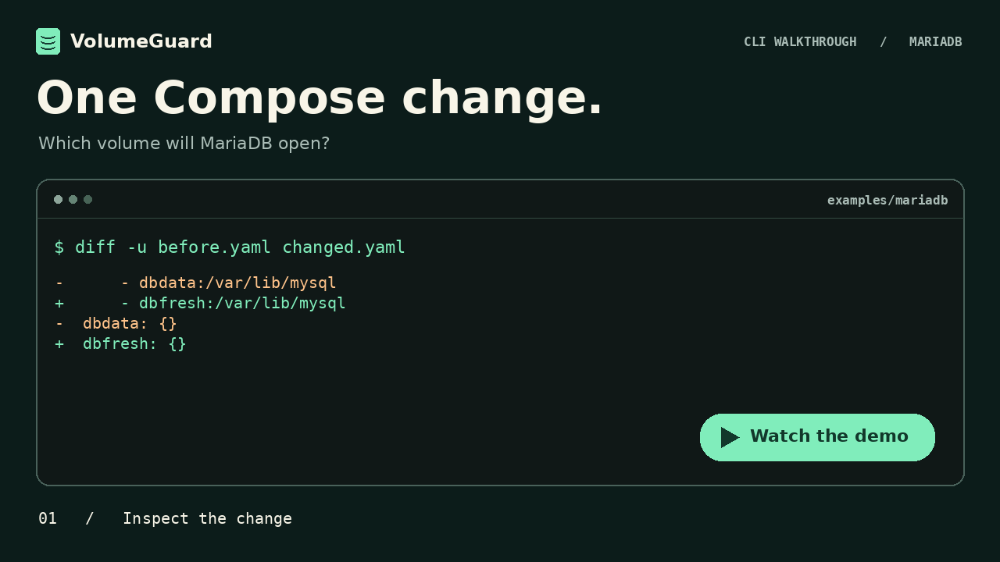

# VolumeGuard

**Know which volume your database will open before you merge a Docker Compose change.**

A pull request changes `dbdata` to `dbfresh`. The YAML is valid. MariaDB can start successfully and show an empty database because the original data is on a different volume. VolumeGuard puts the old and new mount in the pull request, while you can still change the deployment.

[](https://github.com/Berserk-hub150/VolumeGuard/blob/main/docs/volumeguard-demo.mp4)

[Watch the demo · 23 seconds](https://github.com/Berserk-hub150/VolumeGuard/blob/main/docs/volumeguard-demo.mp4) · [Try the example](#try-it-in-a-minute) · [Install the GitHub Action](#use-it-in-a-pull-request)

| Compose edit | What MariaDB will mount at `/var/lib/mysql` | Check |
|---|---|---|
| Change the volume from `dbdata` to `dbfresh` | `moodle_dbdata` → `moodle_dbfresh` | **Review** |
| Rename the YAML key to `course_store` and set `name: moodle_dbdata` | `moodle_dbdata` in both revisions | **Clear** |

## Try it in a minute

With Git and Python 3.9+, clone the repo and run the two comparisons. The YAML parser is bundled. You can run both examples offline after cloning.

```bash
git clone https://github.com/Berserk-hub150/VolumeGuard.git
cd VolumeGuard/examples/mariadb
python3 ../../volumeguard.py before.yaml changed.yaml
python3 ../../volumeguard.py before.yaml safe-rename.yaml
```

On Windows, use `py -3` in place of `python3`. The first command exits with code **1** and prints the affected mount:

```text
db at /var/lib/mysql — storage source changed
  Before: volume moodle_dbdata
  After:  volume moodle_dbfresh
```

The second exits with code **0**. [Compare the three Compose files](examples/mariadb).

## Use it in a pull request

Copy [the ready-to-use workflow](examples/workflows/volumeguard.yml) into your repository at `.github/workflows/volumeguard.yml`. Change `compose-file` if your deployment file lives elsewhere. The workflow pins the action to a specific commit. Once the workflow is on your base branch, open a PR that edits your Compose file.

- **Same-repository PRs** get a job summary and, when permissions allow, a single comment that updates as you push fixes. Fork PRs get the job summary.
- **Roll out gradually** by setting `fail-on-change: 'false'` for advisory findings. Incomplete checks still fail. For summary-only mode, omit `comment-token` and the `pull-requests: write` permission.
- **Require review before merge** by adding the review job as a required status check in your repository rules.

VolumeGuard reads the configured file from the base revision and the proposed merge commit. The check reads Git blobs without starting the stack.

## What gets flagged?

| Result | Meaning |
|---|---|
| **0 · Clear** | Existing declared storage sources match. New services and mounts alone are allowed. |
| **1 · Review** | An existing source, volume subpath or driver configuration changed, or a service or mount disappeared. |
| **2 · Incomplete** | A file is invalid, a storage variable is unresolved, or the configuration requires unsupported deployment context. |

Pass `--format json` for machine-readable output. Use `--project-name` locally or `project-name` in the Action when the deployment sets its project name explicitly. VolumeGuard otherwise uses the top-level Compose `name` or a directory-based fallback. The PR check uses the repository name for a file at the root.

Each comparison covers one effective Compose file per revision. For deployments with overrides, interpolation or includes, render each trusted revision with the same deployment inputs using `docker compose config --format json` and pass the two resulting files to the CLI. Rendered files may contain sensitive environment values.

The result describes declared storage configuration. Checking database contents, image-defined paths, anonymous volume IDs, host symlinks or the success of a migration requires access to the deployment. Relative bind paths are compared lexically. Access-mode-only changes are outside the scope of this check.

## See what happens to the data

With Bash, Docker Compose v2 and a running Docker engine, run this from the repository root:

```bash
bash examples/mariadb/reproduce.sh
```

The script creates **12 sample rows** in an isolated MariaDB instance. It checks that the demo database is absent after switching volumes, then reattaches the original volume and checks that all 12 rows return. It uses a random Compose project name, publishes no host ports and cleans up its own demo volumes.

## Development

Run the suite from the repository root with `python3 -m unittest discover -s tests -v`. GitHub Actions is configured to run the Python suite and the Docker-backed reproduction. VolumeGuard uses the [MIT license](LICENSE). The bundled PyYAML parser retains its [upstream license](vendor/LICENSE-PyYAML).
